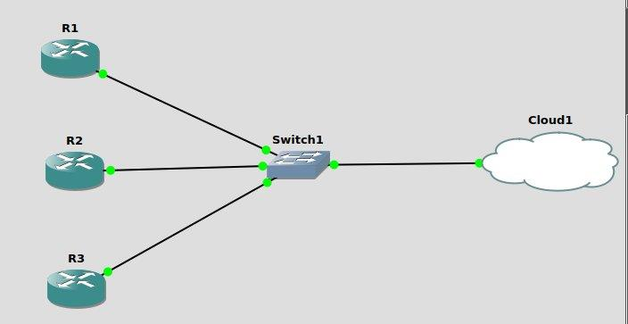
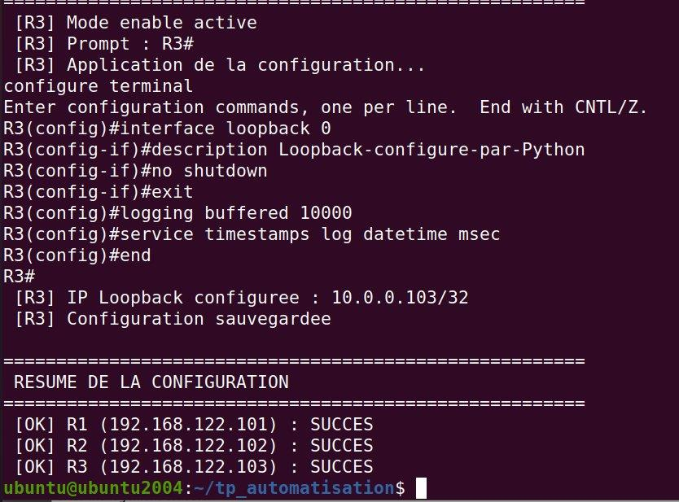
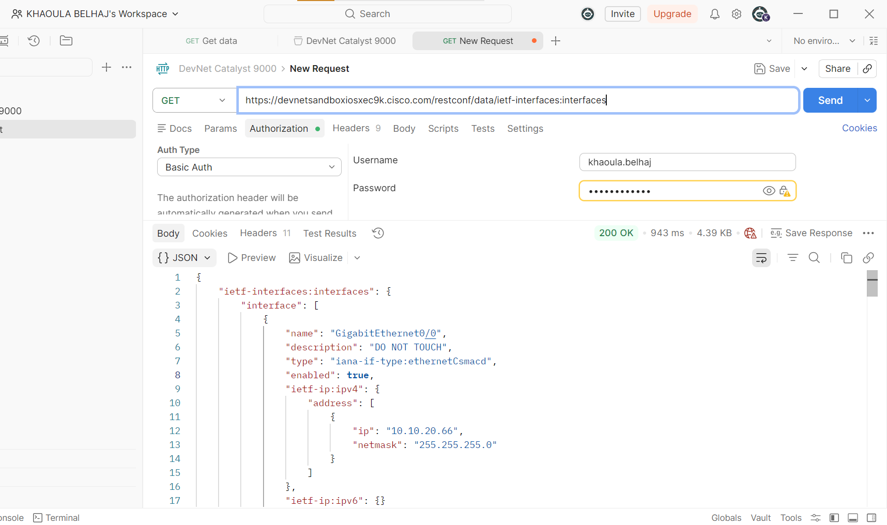
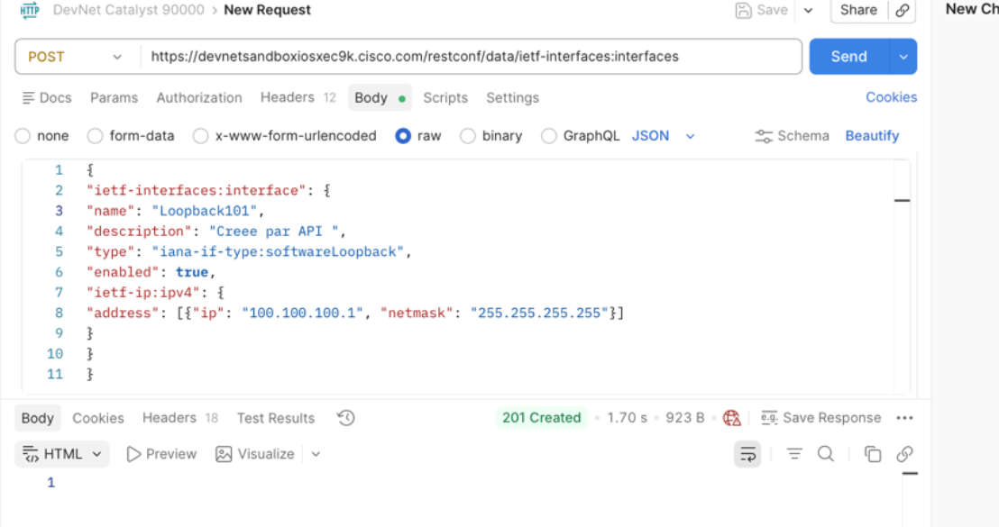

# Network Automation — Python (Netmiko, Paramiko) & RESTCONF

Automating Cisco routers and switches in two ways: **SSH-based scripting with Python** (Netmiko / Paramiko) on routers emulated in GNS3, and **model-driven programmability with RESTCONF / YANG** on a real Cisco Catalyst 9000 (Cisco DevNet sandbox).

> Academic project — Network Automation module, ENSA Fez (GSCSI), April 2026.

     

---

## Part 1 — Python automation over SSH (GNS3)

### Lab topology

Three Cisco c7200 routers (IOS 12.4(24)T5) connected through a switch to a GNS3 Cloud node bridged to the Ubuntu host (`virbr0`), so Python scripts reach each router over SSH.

| Router | Management IP | Loopback (auto-computed) |
|---|---|---|
| R1 | 192.168.122.101 | 10.0.0.101/32 |
| R2 | 192.168.122.102 | 10.0.0.102/32 |
| R3 | 192.168.122.103 | 10.0.0.103/32 |

Each router was prepared for automation: IP domain, RSA key generation, local user, VTY lines and **SSH v2**.

### The six scripts

| # | Script | What it does | Result |
|---|---|---|---|
| 1 | Audit | Connects with Netmiko and runs 6 diagnostic commands (version, interfaces, config, routes, memory, CPU) | Timestamped audit file `audit_R1_<date>.txt` |
| 2 | Monitoring | Refreshes interface status every 10 s (`while True`, `time.sleep`), clean stop on Ctrl+C (`try / except KeyboardInterrupt / finally`) | Live monitoring, guaranteed disconnection |
| 3 | Configuration | Pushes interface configuration with `send_config_set()` and saves it (`save_config()` → `write memory`) | Configuration applied and saved |
| 4 | Paramiko (low level) | Interactive session with `invoke_shell()` + `terminal length 0` | 3 commands executed |
| 5 | Multi-router config | Same configuration pushed to R1, R2 and R3; loopback IP derived from the last octet of the management IP | 3 / 3 routers — SUCCESS |
| 6 | Reporting | Collects 5 commands per router (`show version`, `show ip interface brief`, `show ip route`, `show processes cpu`, `show running-config`) | Report generated in **TXT** (human-readable) and **JSON** (machine-readable) |

### Problems solved

- **Subnet mismatch** between the Ubuntu host and R1 → re-addressed R1 into the host network.
- **Wrong Cloud interface** (`ens33` instead of `virbr0`) → rebound the Cloud node, connectivity restored.
- **SSH algorithm mismatch** between a recent OpenSSH client and an old IOS → dedicated `~/.ssh/config` with compatible algorithms.
- **Paramiko `exec_command()` closing the session** on old IOS → switched to `invoke_shell()` and disabled paging (`terminal length 0`).

### Netmiko vs Paramiko

| | Paramiko | Netmiko |
|---|---|---|
| Level | Generic SSH library | Built on Paramiko, network-aware |
| Cisco prompts, `enable`, `conf t`, `--More--` paging | Handled manually | Handled automatically |
| Best for Cisco devices | No | Yes |

---

## Part 2 — RESTCONF / YANG on a Cisco Catalyst 9000

Using **Postman** against the always-on **Cisco DevNet IOS-XE sandbox** (Basic Auth, header `Accept: application/yang-data+json`).

| Step | Request | Status |
|---|---|---|
| HTTP basics on a public API (JSONPlaceholder) | `GET /users`, `GET /users/3`, `GET /users/999` | 200 OK / 404 Not Found |
| Connection test | `GET /restconf` | 200 OK |
| Without authentication | `GET /restconf` | **401 Unauthorized** — management plane protected |
| Device capabilities | `GET /restconf/data/netconf-state/capabilities` | 200 OK |
| List all interfaces | `GET /restconf/data/ietf-interfaces:interfaces` | 200 OK |
| Read one interface / IPv4 only | `GET …/interface=<name>` · `…/ietf-ip:ipv4` | 200 OK |
| **Create a loopback interface** | `POST /restconf/data/ietf-interfaces:interfaces` | **201 Created** |
| Update only its description (PATCH vs PUT) | `PATCH …/interface=<loopback>` | 204 No Content |
| Delete it | `DELETE …/interface=<loopback>` | 204 No Content — a second DELETE returns 404 |

**Why it matters:** `show ip interface brief` returns unstructured text that scripts must parse; RESTCONF returns structured JSON defined by YANG models, which makes automation reliable and predictable.

---

## Skills demonstrated

Network automation · Python · Netmiko · Paramiko · SSH hardening on Cisco IOS · GNS3 · REST APIs · RESTCONF · YANG · JSON · Postman · troubleshooting

## Documentation

- [Full report — Python automation (Netmiko / Paramiko)](docs/report-python-netmiko-paramiko.pdf) (French)
- [Full report — RESTCONF & RESTful APIs](docs/report-restconf-apis.pdf) (French)

---

**Author:** Khaoula Belhaj — final-year engineering student, Communicating Systems & Computer Security, ENSA Fez · [LinkedIn](https://linkedin.com/in/khaoula-belhaj-1999163a6)
